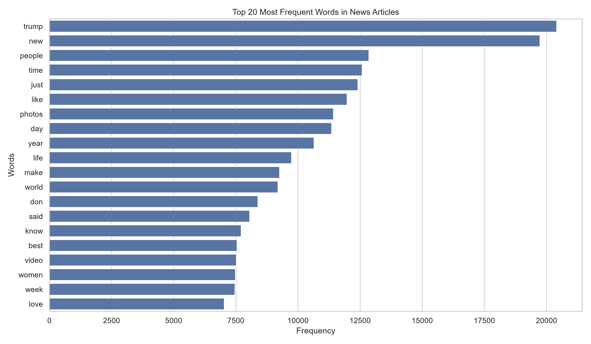
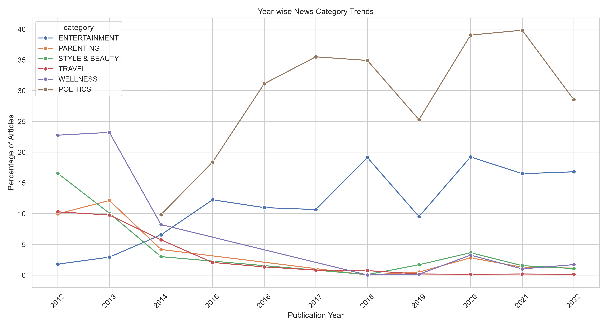
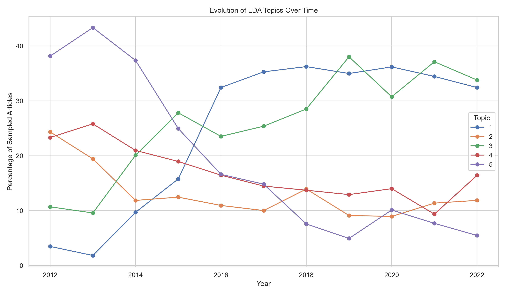
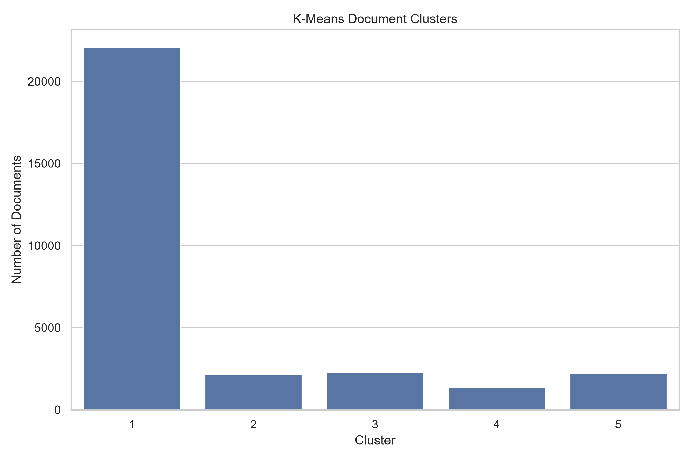

# 📊 Advanced Analysis and Reporting of Language Trends Using NLP Techniques


## 📌 Project Overview

This project focuses on analyzing language trends in news articles using Natural Language Processing (NLP) and Machine Learning techniques.

Using the HuffPost News Category Dataset, the project identifies frequently used words, discovers hidden topics, analyzes yearly news category trends, and groups similar news articles using clustering algorithms.

The analysis provides insights into how news language and topics change over time.

## 👨‍🎓 Project Information

| Detail | Information |
|---|---|
| Student Name | Arfat Shakil Sherkhan |
| Degree | B.Tech – Artificial Intelligence and Machine Learning |
| University | Sanjay Ghodawat University |
| Academic Year | 2026–2027 |
| Project | Week 4 Internship Project |

## 🎯 Objectives

- Analyze frequently occurring words in news articles.
- Identify yearly news category trends.
- Discover hidden topics using Latent Dirichlet Allocation (LDA).
- Group similar news articles using K-Means clustering.
- Evaluate NLP and clustering model performance.
- Generate visualizations, CSV outputs, and analytical reports.

## 📂 Dataset Information

**Dataset:** News Category Dataset v3  
**Source:** [Kaggle – News Category Dataset](https://www.kaggle.com/datasets/rmisra/news-category-dataset)

The dataset contains HuffPost news headlines, descriptions, categories, and publication dates.

| Dataset Details | Value |
|---|---:|
| Valid articles analyzed | 209,497 |
| News categories | 42 |
| Date range | 2012–2022 |
| Advanced model analysis sample | 30,000 |

## 🛠️ Technologies Used

- **Programming:** Python 3.12
- **Data Processing:** Pandas, NumPy
- **Text Processing:** NLTK
- **Machine Learning:** Scikit-learn
- **Topic Modeling:** Latent Dirichlet Allocation (LDA)
- **Clustering:** K-Means
- **Visualization:** Matplotlib, Seaborn, WordCloud
- **Reporting:** Python-docx

## ⚙️ Project Methodology

1. Dataset collection and loading.
2. Data cleaning and preprocessing.
3. Text normalization and stopword removal.
4. Word frequency analysis.
5. Yearly category trend analysis.
6. Topic modeling using LDA.
7. Document clustering using K-Means.
8. Model evaluation.
9. Visualization and report generation.

## 📈 Project Visualizations

### 1. Word Frequency Analysis



### 2. Yearly Category Trends



### 3. Topic Trends



### 4. K-Means Cluster Distribution



## 📊 Key Results

| Analysis | Result |
|---|---:|
| Valid news articles | 209,497 |
| News categories | 42 |
| Most frequent word | Trump |
| LDA topics discovered | 5 |
| K-Means clusters created | 5 |
| LDA perplexity | 2637.02 |
| K-Means silhouette score | 0.003 |

### Model Evaluation

**LDA:** The model discovered five underlying topics in the analyzed news articles. Its perplexity score was 2637.02.

**K-Means:** Five document clusters were generated. The silhouette score of 0.003 indicates weak cluster separation, which is a limitation of the current clustering approach.

## 📁 Project Structure

```text
Week4_Language_Trends_NLP/
│
├── outputs/
│   ├── analysis_summary.json
│   ├── cluster_distribution.png
│   ├── cluster_keywords.csv
│   ├── document_analysis_results.csv
│   ├── lda_topics.csv
│   ├── model_evaluation.csv
│   ├── top_words.png
│   ├── topic_trends.png
│   ├── word_frequency.csv
│   ├── yearly_category_trends.csv
│   ├── yearly_category_trends.png
│   └── yearly_topic_trends.csv
│
├── report/
│   ├── Week4_NLP_Analysis_Report.docx
│   └── Week4_NLP_Analysis_Report.pdf
│
├── src/
│   ├── analysis.py
│   ├── analysis_backup.py
│   └── create_report.py
│
├── .gitignore
├── README.md
└── requirements.txt
```

## 🚀 How to Run the Project

### Step 1: Clone the repository

```bash
git clone https://github.com/arfatsherkhan786-a11y/Week4_Language_Trends_NLP.git
```

### Step 2: Navigate to the project directory

```bash
cd Week4_Language_Trends_NLP
```

### Step 3: Create a virtual environment

```bash
python -m venv venv
```

Activate it on Windows:

```powershell
.\venv\Scripts\Activate.ps1
```

### Step 4: Install dependencies

```bash
pip install -r requirements.txt
```

### Step 5: Download the dataset

Download the dataset from Kaggle and place the required dataset file in the project's `data/` folder.

### Step 6: Run the analysis

```bash
python src/analysis.py
```

### Step 7: Generate the report

```bash
python src/create_report.py
```

**Note:** The dataset is not included in this GitHub repository. Make sure to download it separately before running the analysis.

## 📄 Project Report

The complete project report is available in the repository:

- [Download/View PDF Report](report/Week4_NLP_Analysis_Report.pdf)
- [View Word Report](report/Week4_NLP_Analysis_Report.docx)

## 🏁 Conclusion

This project demonstrates how Natural Language Processing and Machine Learning techniques can be applied to large-scale news article analysis.

Word frequency analysis, yearly trend analysis, topic modeling, and document clustering help identify meaningful patterns in news content.

The project also highlights the importance of model evaluation and understanding the limitations of clustering algorithms.

## 📚 References

- [HuffPost News Category Dataset – Kaggle](https://www.kaggle.com/datasets/rmisra/news-category-dataset)
- [Scikit-learn Documentation](https://scikit-learn.org/)
- [NLTK Documentation](https://www.nltk.org/)
- [Pandas Documentation](https://pandas.pydata.org/)

---

**Developed by Arfat Shakil Sherkhan**  
B.Tech – Artificial Intelligence and Machine Learning  
Sanjay Ghodawat University
